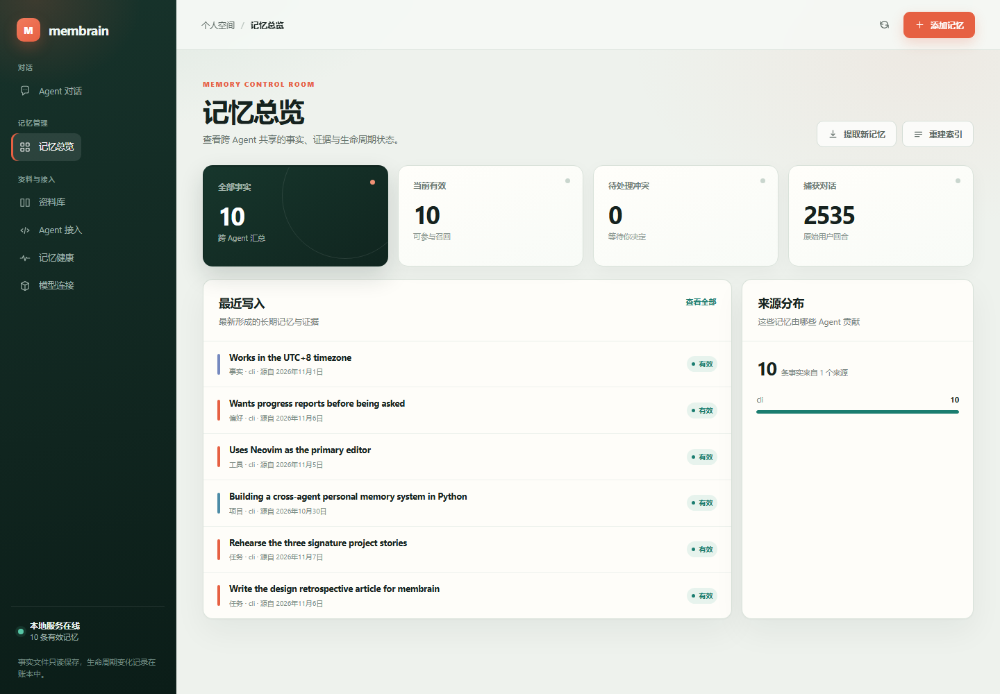

# membrain

[](https://github.com/longtimecar/Multi_Agent_Public_Brain/actions/workflows/tests.yml)

Portable, user-owned long-term memory shared across AI agents.

Design and reasoning: [docs/DESIGN.md](docs/DESIGN.md). Status and next tasks:
[docs/PLAN.md](docs/PLAN.md). New here? Start with the
[onboarding handbook](docs/ONBOARDING.md) — architecture, module map, data flow,
setup, and maintenance rules in one file.

Your memory lives in **Markdown and JSONL files you own**. The database is a
disposable index. Any MCP client can read and write it; agents with lifecycle
hooks capture and recall automatically.

## Why files first

| Layer | What | Disposable? |
|---|---|---|
| Canonical | `memory/facts/*.md`, `memory/episodes/*.jsonl`, `memory/profile.md`, `memory/ledger.jsonl` | **No — this is the product** |
| Derived | `memory/.index/memory.db` | Yes, rebuilt by `membrain reindex` |
| Access | MCP server (`membrain-mcp`) + agent hooks (`scripts/hook.py`) | Yes |

Delete the entire `.index/` directory and nothing is lost. That is the property
that makes this memory yours rather than a vendor's.

## Design rules

1. **Append-only.** Fact files are never edited after write. Lifecycle changes
   (`retract`, `contest`, `resolve`, `supersede`) are appended to
   `ledger.jsonl` and folded at read time.
2. **No `trait` type.** The ontology has `constraint`, `fact`, `preference`,
   `goal`, `project`, plus `task`, `tool`, `entity`, `event`, `case` and `belief`.
   Inferred personality and decision-style claims are not representable, so no
   prompt can drift the system into a flattering caricature.
3. **Evidence or nothing.** Every claim carries a verbatim quote and the
   episode it came from. No quote, no write.
4. **Confidence is computed in code.** Models cluster at 0.8-0.9 regardless of
   truth, so the score comes from evidence count, time spread, stated-vs-inferred,
   and contradiction status.
5. **Confidence tracks evidence, not just count.** A plain first-person statement
   ("I'm allergic to peanuts") is asserted from one episode (0.62–0.70); a hedged
   one ("maybe", "也许") stays under 0.40 until it recurs across days. Silence
   never counts as confirmation.
6. **Conflicts are surfaced, never auto-resolved.** Detection is automatic and
   mechanical; resolution is `membrain resolve`, by you.
7. **Constraints are human-only.** No MCP tool can write a `constraint`, so a
   poisoned tool result cannot become a standing instruction.

## Install

```bash
git clone https://github.com/longtimecar/Multi_Agent_Public_Brain.git
cd Multi_Agent_Public_Brain
uv sync
uv run membrain init
```

`membrain init` creates an empty `memory/` tree on your machine. The repository
ships **no memories and no keys** — there is nothing of the author's in it to
accidentally inherit.

Credentials go in `.env` at the repository root. It is gitignored; copy the
template and fill it in:

```bash
cp .env.example .env
```

Real environment variables override `.env`. `uv run membrain stats` reports
which file was loaded and what is configured, without printing any key.

Embeddings are optional: without them retrieval falls back to full-text.
Any OpenAI-compatible `/embeddings` endpoint works, including a local server.
After setting or changing the embedding model, run `uv run membrain reindex`.
Qwen3 retrieval queries get an instruction by default; override it with
`MEMBRAIN_EMBED_QUERY_INSTRUCTION`. `MEMBRAIN_SEMANTIC_FLOOR` controls the
minimum similarity (default `0.41`). Calibrate for the configured model with
`uv run python scripts/calibrate.py`. The labelled cases include hard negatives;
the command reports unrelated injections and fails on missed related cases. Add
`--strict` to fail on unrelated injections too. One threshold cannot
guarantee that every unrelated query is excluded. When embeddings are unavailable
or a fact has no vector, lexical fallback can also return unrelated matches.
The configured LLM extracts facts in the background after captured turns.
Run `uv run membrain extract` to process pending turns manually; extraction
errors are reported and pending turns can be retried.

OpenViking history is optional and disabled by default. Point
`MEMBRAIN_OPENVIKING_ROOT` at the OpenViking user folder only if you want the
legacy import card to scan it. With no value set, membrain never looks for a
built-in OpenViking path on your machine.

## Use

```bash
uv run membrain add "Prefers terse answers" --type preference --subject communication --quote "keep it short"
uv run membrain add "Never use em dashes" --type constraint --subject style
uv run membrain list
uv run membrain search "any dietary considerations?"
uv run membrain show f_20261031_abcdef
uv run membrain correct f_20261031_abcdef --reason "user says this is outdated"
uv run membrain resolve f_NEW --drop f_OLD
uv run membrain reindex
uv run membrain stats
uv run membrain extract
uv run membrain doctor
```

For a browser-based memory manager, run `uv run membrain dashboard`. It opens
the local dashboard at `http://127.0.0.1:1966/` and uses the same memory files
as the CLI and MCP server. The service binds to loopback only. Its interface
can add facts from owner-entered quotes, replace or retract memories, review
conflicts, trigger extraction, and rebuild the disposable index. Fact Markdown
files remain immutable; lifecycle changes are appended to the ledger.



`add --type constraint` is the only way to create a hard constraint. That is
deliberate.

## Agent integration

**MCP (portable floor).** Copy `.mcp.json.example` to `.mcp.json` and replace
`<PROJECT>` with the absolute path of your checkout; point your MCP client at
that file. Thirteen tools: `record_user_message`, `search_memory`,
`find_memory`, `find_user_evidence`, `write_memory`, `correct_memory`,
`search_archive`, `browse_archive`, `read_archive`, `read_memory_diff`,
`list_contested`, `get_profile`, `memory_stats`. Agent writes require a captured
user episode and an exact quote; `find_user_evidence` locates its ID.
`search_memory` also returns `episodes` — the raw turns behind an answer — and
`time_window` when your question named a day, so an agent can say where an
answer came from instead of presenting a transcript fragment as settled memory.

**Hooks (automatic).** `harness/` holds one ready-made hook config per agent.
The installer fills in your path and copies the config into place:

```bash
uv run python scripts/install_harness.py          # dry run — prints the plan
uv run python scripts/install_harness.py --apply   # writes the configs
uv run python scripts/install_harness.py --apply --agent cursor
```

Session start injects profile + constraints + goals; each prompt injects a
budgeted relevant-memory block; each stop appends new turns to a raw episode
file with no model call.

**Claude Code** wires `scripts/hook.py` to `SessionStart`, `UserPromptSubmit`,
`Stop`, `PreCompact`, `SessionEnd` through `.claude/settings.json`.

Other agents use the same shim with their own event names — Codex and Cursor
expose hooks, Gemini CLI uses `SessionStart` / `BeforeAgent` / `SessionEnd`,
OpenCode uses a plugin. Anything without hooks still gets memory through MCP.

**What is not supported, on purpose:** scraping web chat UIs and HTTPS
interception. They break on every redesign, violate terms of service at every
vendor simultaneously, and lose fidelity. Use the official data export for
backfill instead.

## Capture, tasks and time

Auto-capture tails every known agent's local session store, so writing never
depends on a model choosing to call a tool. It runs inside the dashboard, or on
its own:

```bash
uv run membrain watch --once       # one capture pass, then exit
uv run membrain watch              # keep capturing in the foreground
uv run membrain autostart          # install capture-at-login (Windows)
uv run membrain autostart --remove
```

Capture is not hosted by the dashboard on purpose: a night with no browser tab
open used to be a night with no memory.

Captured turns keep the time they were actually said, not the time they were
scanned, and each one records whether that time is `exact` (read from the
agent's own log) or `estimated` (the source kept no per-turn time). Turns are
filed under the operator's calendar day — set `MEMBRAIN_TZ` if the machine's
timezone is not the one you think in.

That is what makes time-phrased questions answerable:

```bash
uv run membrain search "我昨晚说今天的任务是什么"
uv run membrain tasks              # open tasks handed to a later session
uv run membrain consolidate        # session summaries (derived view, not evidence)
```

`search_memory` resolves "昨晚 / yesterday / 上周 / 3 days ago" deterministically
— no model call in the recall path — demotes memories whose evidence falls
outside that window, and falls back to the raw captured turns when the curated
facts cannot answer. A question that names a *type* ("我的任务") is answered by
lookup rather than similarity, because no amount of text overlap connects 任务
to a claim that says 时间戳修复.

Summaries under `memory/summaries/` are a derived view: they never enter the
facts index and can never be used as evidence, so a model's restatement cannot
become a memory.

## Hygiene

```bash
uv run pytest -q
```

Covers: fact round-trip, append-only immutability, ledger folding, confidence
capping, same-day corroboration not promoting, lexical and semantic recall,
budget enforcement without mid-item truncation, conflict surfacing without
resolution, explicit resolution, index rebuild from Markdown, and evidence
validation.

For live workflow checks see [docs/TESTING.md](docs/TESTING.md). Capture and
recall are exercised in daily use across Claude Code, Codex, Qoder and other
hooked agents; `uv run membrain doctor` reports backend reachability, index
health and which agents are connected on your machine.
