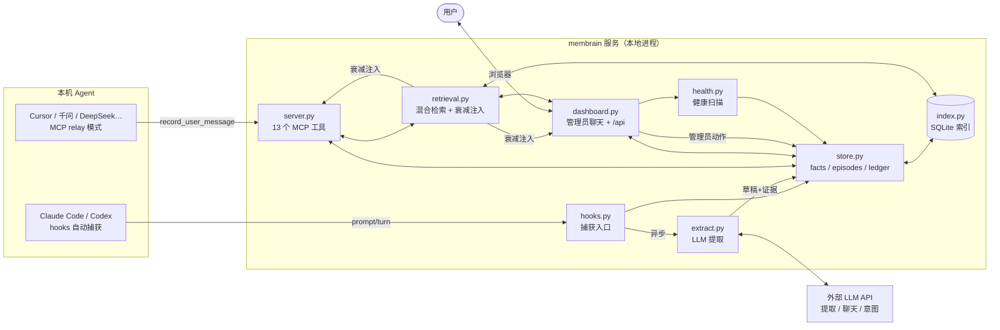
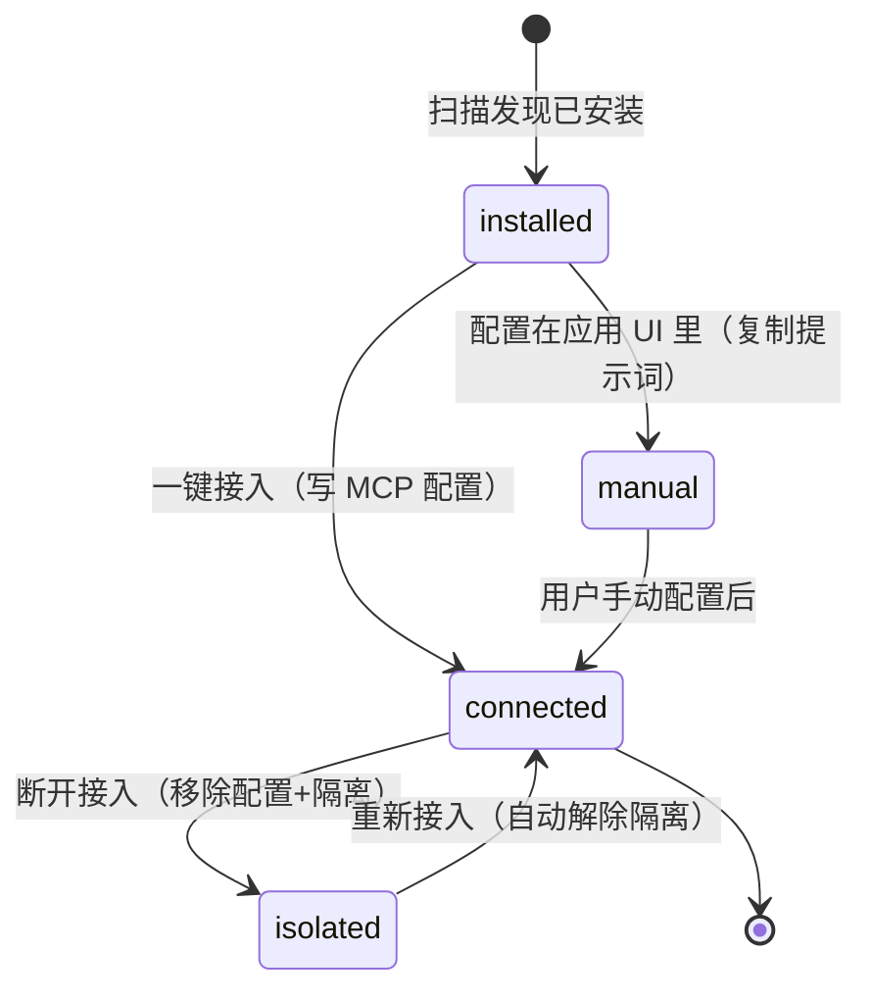

# membrain 新接手者手册

> 第一次接触本仓库的话，从这份文档开始：装环境、认模块、搞懂数据怎么流动，
> 以及动手前有哪些地方不能碰。设计动机的完整论述在 [DESIGN.md](DESIGN.md)，
> 任务清单在 [PLAN.md](PLAN.md)。

## 阅读指南：先读哪几章

**只想把 membrain 用起来**（部署、配置、日常管理）：读 **1（项目定位）→ 6（搭建运行）
→ 8（配置参考）** 三章就够用了。"Agent 能做什么、断开会怎样"这类问题查 **9.4 能力边界**
和 **9.5 生命周期**。

**要改 membrain 的代码**：按顺序通读 **2（设计规则）→ 3（技术栈）→ 4（目录导览）→
5（架构与数据流）→ 9（Agent 体系）→ 10（红线）**。第 2 章和 10.2 是动代码前的硬性前置。

有两章归属模糊：第 7 章前半（跑测试、跑校准）算运维，后半（用例结构）算开发；
9.2 讲的识别机制是给开发的，但"为什么我的 Agent 没被识别出来"的答案也在那里。

---

## 1. 这个项目是什么

**membrain 是一个可移植、用户自有、跨 Agent 共享的个人长期记忆系统。**

起因很实际：我同时在用五六个 AI Agent，每个都要重新自我介绍；它们对我的认知经常互相
矛盾，A 说我不吃辣，B 推荐水煮鱼；记忆绑在各自平台上，换工具就丢；时间长了，整理和
纠正这些记忆本身就成了一摊事。所以做了 membrain——一个跑在本地的记忆服务：

- 任何 Agent（Claude Code、Codex、Cursor、千问……）通过 **MCP 协议**或 **hooks** 读写
  同一份记忆；
- 记忆以 **Markdown + JSONL 明文文件**存在用户自己的磁盘上，数据库只是可重建的索引；
- 任何写入都必须携带**用户原话作为证据**，模型不能凭空捏造记忆；
- 生命周期（更正/撤回/冲突）走**追加式账本（ledger）**，原始文件永不改动。

记忆是用户的资产，membrain 只负责管理它。

---

## 2. 核心设计规则（改动前必读）

这几条不是风格偏好，是踩过坑之后定下的约束，改代码前先看完：

1. **Append-only**：`facts/<id>.md` 写入后永不原地修改。生命周期变化追加到
   `ledger.jsonl`，读取时 fold 出当前状态。
2. **证据优先（No quote, no write）**：每条记忆必须带用户原话的逐字引用和来源
   episode。MCP 层和 Dashboard 聊天层都强制校验 `quote` 是用户本轮消息的子串。
3. **置信度由代码计算**：`confidence.py` 从证据结构（条数、时间跨度、stated/inferred、
   矛盾状态）推导，**从不信任模型自评**。单条观察封顶 0.40，明确陈述封顶 0.70。
4. **冲突只呈现、不自动裁决**：检测是机械的（`conflict.py`），裁决只有
   `membrain resolve`（人类）能做。
5. **硬约束（constraint）仅限人类操作**：MCP 工具和 Dashboard 聊天的管理员循环都
   拒绝创建/修改/撤回 constraint。
6. **敏感记忆默认不可见**：religion/politics/belief 类存储但默认不注入，查询主题
   明确相关时才放开。
7. **记忆与代码分离**：`MEMBRAIN_HOME`（默认 `<repo>/memory`）是唯一数据位置，
   重新部署代码不触碰数据。

---

## 3. 技术栈与选型理由

| 层 | 选型 | 为什么 |
|---|---|---|
| 语言 | **Python ≥ 3.11** | 生态、原型速度、团队熟悉度；仅用标准库 + 5 个运行时依赖 |
| Agent 协议 | **MCP（official `mcp` SDK）** | 跨 Agent 事实标准；stdio 传输零网络配置 |
| 数据校验 | **Pydantic v2** | Fact/Episode 的不可变模型 + 严格 ID/长度校验，防脏数据落盘 |
| 结构化文件 | **PyYAML** | fact 文件用 YAML front-matter，人类可读可 grep |
| 数值计算 | **NumPy** | embedding 批量向量、余弦相似度矩阵（健康中心重复检测） |
| 压缩 | **zstandard** | 仅 DeepSeek Harness 转录解压需要（可选依赖 `dsh` extra） |
| 全文/向量索引 | **SQLite（WAL）** | 单文件、可删除重建（`.index/memory.db` 是丢弃层）、无服务依赖 |
| LLM 调用 | **urllib 直连**（OpenAI / Anthropic 两种格式） | 不引入重 SDK；两种协议差异集中在 `llm.py` 一个文件里 |
| 前端 | **原生 HTML/JS/CSS，无框架** | Dashboard 是本地单页工具，无构建步骤、无 node_modules |
| 包管理 | **uv + hatchling** | 快、锁定 `uv.lock`、sdist 打包清单严格控制隐私 |
| 测试 | **pytest** | 269 个用例，全部离线（LLM 用 FakeLLMClient 脚本化） |

也有刻意不用的东西：Web 框架（标准库 `http.server` 够用）、ORM（文件才是事实来源）、
前端框架（不想引入构建链）、向量数据库（SQLite + NumPy 在当前规模下够了）。

---

## 4. 目录结构导览

```
membrain-app/
├── src/membrain/            # 全部核心代码（约 10k 行）
│   ├── server.py            # MCP 服务：13 个工具（search/write/correct/…）+ MemoryService 装配
│   ├── dashboard.py         # 本地 Dashboard（http.server）：全部 /api 路由 + 管理员聊天循环
│   ├── cli.py               # 命令行入口（membrain init/add/search/extract/doctor/…）
│   ├── store.py             # 事实/episode/ledger 的 append-only 存储与原子写
│   ├── retrieval.py         # 混合检索（RRF 融合）+ 敏感过滤 + Agent 隔离 + 召回追踪与衰减注入
│   ├── index.py             # SQLite 索引（FTS + 向量），可随时删除重建
│   ├── embeddings.py        # OpenAI 兼容 embedding 客户端（批量 + 缓存）
│   ├── llm.py               # LLM 客户端（complete_text/complete_json），OpenAI/Anthropic 双格式
│   ├── extract.py           # LLM 记忆提取：从 pending episodes 产出事实草稿
│   ├── hooks.py             # Claude Code / Codex hooks 的 capture/recall 入口
│   ├── models.py            # Fact / Episode / Evidence / Provenance（Pydantic）
│   ├── confidence.py        # 置信度公式（证据结构 → 0~1 分数）
│   ├── conflict.py          # 规则式冲突检测（否定词/反义词/包含度）
│   ├── health.py            # 记忆健康扫描：重复/冲突/噪声/遗忘候选
│   ├── agents.py            # 本机 Agent 扫描、一键接入/断开、隔离清单
│   ├── session_import.py    # 历史会话导入（LLM 清洗提炼，噪声丢弃）
│   ├── session_archive.py   # 会话归档与 memory_diff
│   ├── auto_commit.py       # 空闲时自动归档
│   ├── watcher.py           # 后台自动捕获：轮询各 Agent 本地会话库（可独立于 dashboard 运行）
│   ├── consolidate.py       # 会话摘要 memory/summaries/*.md（派生视图，永不作为证据）
│   ├── rag.py               # 资料库真 RAG：解析→分块→LLM 摘要→向量化→混合检索
│   ├── openviking_import.py # 可选的 OpenViking 历史数据导入（不设置根目录绝不扫描）
│   ├── budget.py            # token 预算估算（注入量控制）
│   ├── injection.py         # 注入格式化
│   ├── context_pack.py      # context 模式的类型配额打包
│   ├── evolution.py / merge_policy.py / overview.py / peer.py / rerank.py /
│   │   intent.py / search_mode.py / skills_index.py / resources.py / uri.py
│   │                        # Scheme A 扩展（可选，默认关）与辅助模块
│   ├── text.py              # 用户原文清洗（剥掉注入块/系统通知，防污染）
│   ├── config.py            # 全部环境变量解析（.env 优先级低于真实环境变量）
│   ├── locking.py           # 跨进程文件锁
│   └── web/                 # Dashboard 前端三件套（index.html / app.js / styles.css，原生 JS）
├── tests/                   # pytest 套件（269 用例）+ fixtures/recall_pairs.json（召回黄金样例）
├── scripts/
│   ├── hook.py              # hooks 垫片（Agent 配置指向它，它转发给 CLI；相对仓库定位 MEMBRAIN_HOME）
│   ├── calibrate.py         # 召回质量校准 + 基线对比（--update-baseline / --strict）
│   ├── build_release.py     # 发布打包 + 隐私扫描
│   └── install_harness.py   # Cursor/OpenCode/WorkBuddy 的接入安装器
├── harness/                 # 各 Agent 的接入配置模板
├── docs/                    # DESIGN / PLAN / TESTING / 本文档
├── skills/                  # 技能索引数据（Scheme A）
├── memory/                  # ← 数据目录（gitignore；默认在此，可被 MEMBRAIN_HOME 重定向）
└── pyproject.toml           # 依赖 + sdist 白名单（防隐私泄漏进发布包）
```

---

## 5. 架构与运行原理

### 5.1 三层数据模型

| 层 | 位置 | 可丢弃？ | 内容 |
|---|---|---|---|
| Canonical（事实层） | `memory/facts/*.md`、`memory/episodes/*.jsonl`、`memory/profile.md`、`memory/ledger.jsonl` | 否 | 记忆文件、原始用户回合、生命周期账本——这部分是产品本体 |
| Derived（派生层） | `memory/.index/memory.db`、`memory/archive-index` | 是 | SQLite 全文/向量索引；`membrain reindex` 重建 |
| Access（访问层） | MCP 服务、Dashboard、hooks | 是 | 无状态进程，随起随停 |

索引损坏或版本不兼容时，直接删掉 `.index/` 重跑 reindex 就行，一条记忆都不会少。

### 5.2 组件与数据流总览



### 5.3 关键数据流

**捕获 → 提取（写路径）**

1. 用户在某 Agent 里说话 → hooks（Claude Code/Codex）或 MCP `record_user_message`
   （relay 型 Agent）把**用户原话**写成 episode（`episodes/YYYY-MM-DD.jsonl`）。
   注入块（`<system-reminder>`、`<task-notification>` 等）在 `text.py::clean_turn`
   被剥掉；已断开的 Agent 在入口直接拒绝。
2. 后台启动 `membrain extract`（子进程，不阻塞 Agent）：LLM 读 pending episodes，
   产出事实草稿（类型/主题/claim/**逐字引用**）→ `store.write_fact` 重算置信度 →
   落盘 + ledger。
3. 新事实 `sync_fact` 进索引，冲突扫描顺带跑完。

**召回 → 注入（读路径）**

1. Agent 调 `search_memory` / `find_user_evidence`，或 hooks 的 session-start 注入。
2. `retrieval.py::recall`：混合检索（向量 + FTS，RRF 融合）→ 过滤
   （敏感/隔离 Agent/scope/type）→ top_k 选择 → **衰减注入**：30 天内新建或被召回过的
   记忆给完整表述（含 hedged 证据）；超过 30 天没被召回的只给一句话摘要（`aged`
   标记）。证据仍留在文件里，只是不再注入——这是有意的遗忘策略。
3. 每次召回更新 `memory/.state/recall-tracker.json`（节流写盘）。

**生命周期（改路径）**

- 更正 = 写新事实（`supersedes` 指向旧条）+ ledger `supersede`；撤回 = ledger `retract`；
  冲突 = `contest`，解决 = `resolve(keep, drop)`。原始文件永远完整。
- 入口有三处，校验规则一致：MCP 工具、Dashboard L2 详情按钮、Dashboard 聊天管理员
  循环（JSON 动作协议，最多 5 轮，`record` 的 quote 必须是用户原话子串）。

**Agent 接入与隔离**

- `agents.py::scan` 实时扫描（清单 + 关键词兜底 + Windows 卸载列表）；
- 一键接入 = 直接编辑该 Agent 的 MCP 配置文件（先备份）；Claude Code/Codex 受保护，
  只给提示词；
- 断开 = 移除配置（能改的）+ 把 key 写进 `memory/state/disabled-agents.json`：
  其历史记忆从所有召回/列表中隐藏（**不删除**），新捕获被拒绝，重新接入自动解除。

**导入与健康**

- 历史会话导入（`session_import.py`）：发现本机会话 → LLM 清洗分类/生成 L0 摘要 →
  噪声丢弃 → 按来源进资料库；可选"同时提炼为短记忆"（默认关）。
- 健康中心（`health.py`）：重复（embedding 余弦 ≥ 0.88）/冲突/噪声/遗忘候选四类检测 →
  健康分 → 用户逐项决定（合并替代/撤回/忽略）。

---

## 6. 本地环境搭建与运行

前置：Python ≥ 3.11、[uv](https://docs.astral.sh/uv/)、Git。Windows/Linux/macOS 均可。

```bash
# 1. 拉代码
git clone https://github.com/longtimecar/Multi_Agent_Public_Brain.git membrain
cd membrain

# 2. 安装依赖（自动创建 .venv）
uv sync

# 3. 初始化空记忆库（在你自己的仓库目录下创建 memory/）
uv run membrain init

# 4. 配置模型（文件被 gitignore，密钥不会离开本机）
cp .env.example .env
# 编辑 .env，至少填 LLM 三项；embedding 可选（缺省时检索退化为全文匹配）：
#   MEMBRAIN_LLM_BASE_URL / MEMBRAIN_LLM_API_KEY / MEMBRAIN_LLM_MODEL
#   MEMBRAIN_EMBED_BASE_URL / MEMBRAIN_EMBED_API_KEY / MEMBRAIN_EMBED_MODEL
# 换 embedding 模型后记得：uv run membrain reindex

# 5. 启动 Dashboard（浏览器自动打开）
uv run membrain dashboard --port 1966

# 6. 验证
uv run membrain stats        # 报告配置来源与统计，不打印任何密钥
uv run membrain doctor       # 体检：配置/索引/hooks 一并检查
```

**接入你的 Agent**：Dashboard →「Agent 接入」→ 已安装的 Agent 一键接入（自动备份原
配置），或「复制提示词」交给 Agent 自己配置。接入后重启该 Agent 生效。

**常用运维**：

```bash
uv run membrain extract            # 手动提取 pending 回合
uv run membrain reindex            # 重建全部索引（安全）
uv run python scripts/calibrate.py --strict --update-baseline
                                   # 召回质量回归 + 更新基线（需 embedding）
```

---

## 7. 测试与质量保障

```bash
uv run pytest -q                   # 269 个离线用例（无网络、LLM 用 Fake 脚本化）
uv run python scripts/calibrate.py # 召回质量回归（82 组中英文黄金样例 + 硬负例）
```

- **召回回归基线**：结果对比 `state/recall-baseline.json`——通过率降 2% 以上、漏召回
  增加、样例持续失败，都会以非零退出并打印 REGRESSIONS。换 embedding 模型后务必跑
  一次并 `--update-baseline`。
- **已知抖动**：`test_dashboard_rejects_cross_site_memory_writes` 在低负载机上偶发
  （HTTP 线程时序），单跑必过；重跑即可，别因此改业务代码。

---

## 8. 配置参考（环境变量）

全部通过 `.env`（仓库根，gitignore）或真实环境变量设置；后者优先。完整清单见
`.env.example`，常用的：

| 变量 | 作用 | 默认 |
|---|---|---|
| `MEMBRAIN_HOME` | 记忆库根目录 | `<repo>/memory` |
| `MEMBRAIN_ENV_FILE` | 指向别的 .env | `<repo>/.env` |
| `MEMBRAIN_LLM_BASE_URL/_API_KEY/_MODEL/_API_FORMAT/_TIMEOUT` | 提取/聊天用的模型 | 无（未配置则聊天/提取不可用，其余功能正常） |
| `MEMBRAIN_EMBED_BASE_URL/_API_KEY/_MODEL/_TIMEOUT` | 语义检索 embedding | 无（退化为全文检索） |
| `MEMBRAIN_SEMANTIC_FLOOR` | 语义相似度下限 | 0.41（用 `scripts/calibrate.py` 校准） |
| `MEMBRAIN_TURN_TOKEN_BUDGET` / `_SESSION_TOKEN_BUDGET` | 单次/会话注入预算 | 1200 / 2500 |
| `MEMBRAIN_OPENVIKING_ROOT` | 可选的 OpenViking 历史数据源 | 无（不设置绝不扫描） |
| `MEMBRAIN_USE_INTENT` / `MEMBRAIN_USE_RERANK` | Scheme A 实验特性 | 关 |

---

## 9. Agent 体系详解

先说清楚一个容易误解的点：membrain 自己不是 Agent，它是给 Agent 用的外置记忆。
本项目说的"Agent"指任何接入了 membrain 的 AI 助手程序（Claude Code、Codex、Cursor、
千问……），另外还有一个 Dashboard 内置的**记忆管理员**。这一节讲它们怎么被发现、
怎么接入、工作时受什么限制。

### 9.1 核心组成部分

| 组件 | 文件 | 职责 |
|---|---|---|
| 发现与接入框架 | `agents.py` | 扫描本机已安装的 Agent（内置 13 个清单 + 关键词兜底 + Windows 卸载列表）；一键接入/断开（备份后写/删 MCP 配置）；隔离清单判定 |
| hooks 捕获通道 | `hooks.py` + `scripts/hook.py` | Claude Code / Codex 专用：把 Agent 的生命周期事件转成捕获与召回动作 |
| MCP 能力面 | `server.py` | 13 个 MCP 工具，是所有 relay 型 Agent 的唯一能力入口 |
| 记忆管理员 | `dashboard.py::chat` | Dashboard 内置对话 Agent：JSON 动作循环，能自主多步操作记忆 |
| 隔离机制 | `state/disabled-agents.json` + retrieval 过滤 | 断开接入后历史记忆隐藏、新捕获拒绝，重连即恢复 |

分工可以这样理解：agents.py 管准入，决定谁能接进来；hooks 和 MCP 是两条数据通道；
server.py 的工具清单划定了 Agent 能做的操作；隔离清单管的是退出之后留下什么痕迹。

### 9.2 Agent 发现：三种识别手段

`agents.py::scan` 每次调用都实时扫描，没有缓存：

1. **内置清单（SPECS）**：13 个 Agent 的特征（目录路径、命令行）。桌面应用还要求
   Windows 卸载列表里仍存在（`needs_uninstaller`）——豆包卸载后残留的 1.9G 数据目录
   曾被误判为"已安装"，就是这么修掉的。
2. **关键词兜底**：扫卸载列表和 AppData 目录名，命中 KEYWORDS（claude/qwen/kimi/…）
   但不在清单里的，以"其他发现（other:*）"呈现。新 Agent 出来后至少能被报出名字。
3. **不可编辑判定**：配置藏在应用 UI 里的（Trae/Qoder/千问/DeepSeek Harness）标记
   为"需手动接入"，只给提示词，绝不盲写配置。

### 9.3 两种接入模式的工作机制

**模式 A：hooks 自动捕获（Claude Code / Codex）**

```
用户输入 → Agent 事件钩子 → scripts/hook.py → membrain.cli hook → hooks.py::run
  SessionStart        → 组装记忆注入块（profile + 检索结果，带去重指纹）注入上下文
  UserPromptSubmit    → record_prompt：用户原话写成 episode（入口即剥注入块）
  Stop / PreCompact   → capture：转录差分捕获 + 触发后台提取/归档
  SessionEnd          → capture 收尾
```

- `scripts/hook.py` 是垫片：`setdefault(MEMBRAIN_HOME)` 后 re-exec 到项目 venv，
  Agent 配置里写一行命令就够。
- 用户全程无感，捕获全自动；代价是要改 Agent 的配置文件（这类配置受保护，只提供
  提示词）。

**模式 B：MCP relay（其余所有 Agent）**

```
Agent 的 MCP 配置里加 membrain（stdio 子进程）→ 模型在对话中按 RELAY_RULE 调用：
  每轮先 record_user_message(用户原话, agent=自己的名字)
  需要回忆时调 search_memory
```

- 不动 Agent 的任何文件，但依赖模型自觉调用工具；规则文本（`agents.py::RELAY_RULE`）
  通过提示词或长期指令下发。

**模式 C：Dashboard 记忆管理员（内置）**

```
用户在 Dashboard 聊天 → JSON 动作循环（最多 5 轮）：
  模型返回 {"action":"search|detail|stats|list_contested|correct|retract|record|reply","args":{…}}
  服务端白名单执行（证据校验同 MCP 层）→ 结果回传 → 下一轮 → reply 结束
```

- 受控的 agentic loop：能自主多步操作（先 search 再 correct），但动作面被服务端
  白名单收敛，`record` 的 quote 必须逐字来自用户本轮消息。

### 9.4 能力边界

**Agent 能做的（MCP 工具 = 全部能力面）**

| 工具 | 能力 | 关键校验 |
|---|---|---|
| `record_user_message` | 记录用户原话为 episode | 清洗注入块；隔离中的 Agent 被拒绝 |
| `search_memory` | 语义+全文混合召回 | 敏感/隔离/已撤回记忆不可见；衰减注入生效 |
| `find_memory` / `find_user_evidence` | 按精确引用找证据回合 | 为 correct/write 准备证据 |
| `write_memory` | 写新记忆 | 类型限白名单（无 constraint）；quote 必须来自真实用户回合 |
| `correct_memory` | 更正或撤回一条记忆 | 必须引用该记忆来源回合里的**逐字原话**做理由；constraint 拒绝 |
| `search_archive` / `browse_archive` / `read_archive` | 检索资料库（长文档层） | 只读 |
| `read_memory_diff` | 读会话归档的记忆差异 | 只读 |
| `list_contested` / `get_profile` / `memory_stats` | 状态查询 | 只读 |

**Agent 不能做的（设计边界，全部服务端强制）**

| 禁区 | 原因 |
|---|---|
| 写、改、撤 **constraint**（硬约束） | 硬约束是用户的红线，只有本人能在 L2 详情操作 |
| 无证据写入 | "No quote, no write"——伪造 quote 会被逐字校验拒绝 |
| 读取敏感记忆（默认） | 宗教/政治/信仰类只在查询主题明确相关时放开 |
| 修改 fact 文件 / 裁决冲突 | append-only：变化只能走 ledger；resolve 是人类专属 |
| 越过隔离 | 断开的 Agent 连自己的历史都看不到，重连才恢复 |
| 直接访问文件系统 | 一切经过 MCP 工具的参数校验；没有"打开文件"类能力 |

**管理员 Agent 的额外限制**：动作面被白名单收敛到 8 个动作；编造 memory_id、伪造
quote、JSON 不合规都会被拒绝并要求重试；连续两次无效输出就降级为固定提示，绝不
带病写入。

### 9.5 生命周期：接入 → 活跃 → 断开 → 恢复



- **connected**：正常捕获与召回。
- **isolated**：历史记忆从所有召回和列表里隐藏（数据不删），新捕获被拒绝；卡片
  显示"已隔离"。
- 要记住的一点：断开只是把记忆挡在查询结果外面，文件一个字节都没动。重新接入，
  一切原样回来。

### 9.6 与其他部分的关系

- **衰减注入（5.3）对所有 Agent 一致**：不管 hooks 还是 relay，注入的详细程度都由
  服务端按"30 天使用窗口"决定——Agent 不需要、也不应该自己实现遗忘。
- **置信度与冲突是共享状态**：一个 Agent 写的记忆如果和另一个 Agent 写的矛盾，
  冲突对会被标出来，在健康中心和冲突页呈现给人类裁决。
- **隔离清单**由 Dashboard 维护，MCP 层与 hooks 层都读它——三个入口的边界保持一致。

---

## 10. 升级方向与注意事项

### 10.1 路线图（按 PLAN.md 与当前进度）

| 方向 | 状态 | 说明 |
|---|---|---|
| 记忆健康中心 | ✅ 已实现 | `health.py` 四类扫描；可扩展"合并为一条"的 LLM 辅助起草 |
| 召回质量回归 | ✅ 已实现 | 82 组样例 + 基线对比；样例可持续扩充 |
| Agent 断开/隔离 | ✅ 已实现 | 资料库（archive）的来源过滤尚未覆盖，为已知缺口 |
| 统一画像生成 | ⬜ 下一步 | 从 active 记忆生成带证据编号的 profile 摘要（`profile.md` 已有挂载点） |
| 备份/恢复命令 | ⬜ | `membrain backup/restore/verify`：打包 + ledger 校验 + 索引重建 |
| 外置 agents.json | ⬜ | Agent 识别清单外置成数据文件，社区可贡献 |

### 10.2 改动红线（这几条动了就是事故）

1. **不要原地修改 fact 文件的 claim/evidence**。一切变化走 ledger；衰减机制也刻意
   做在注入层，而不是删证据。
2. **不要绕过证据校验**。新加的写入口都必须校验 quote 是用户原话子串；constraint
   永远不给模型写。
3. **不要把绝对路径或个人信息写进 src**。所有路径从 `Settings` 来；提交前跑
   `scripts/build_release.py` 的隐私扫描或等价 grep。
4. **不要在 recall 热路径里做同步 LLM 调用**。intent/rerank 都是 fail-open 且可关；
   提取永远走后台子进程。
5. **`web/` 保持无构建依赖**。想引入前端框架，先论证为什么原生 JS 不够。
6. **维护 sdist 白名单**（pyproject `[tool.hatch.build.targets.sdist]`）。新增顶层
   目录时记得同步，防止本机数据被打进发布包。

### 10.3 排查速查

| 症状 | 先看 |
|---|---|
| Agent 没有记忆注入 | `membrain doctor`；Agent 配置里的 `MEMBRAIN_HOME` 是否一致 |
| 记忆"消失"了 | 是否断开了来源 Agent（隔离）；健康中心是否建议撤回；`fact_is_stale` 只是摘要化，数据仍在 |
| Dashboard 聊天不动 | `.env` 的 LLM 配置；模型连接页"测试模型连接"；`memory/.state/extract.log` |
| 提取没产出 | `membrain extract --session <id>` 手动跑；检查 LLM 返回是否合法 JSON |
| 检索不准 | `scripts/calibrate.py` 跑基线对比；确认 embedding 配置后已 `reindex` |

---

*文档对应代码版本 `5063544` 之后的时间感知/任务记忆改造（2026-11-05）。发现文档和代码
对不上时，以代码为准，欢迎顺手修文档。*
